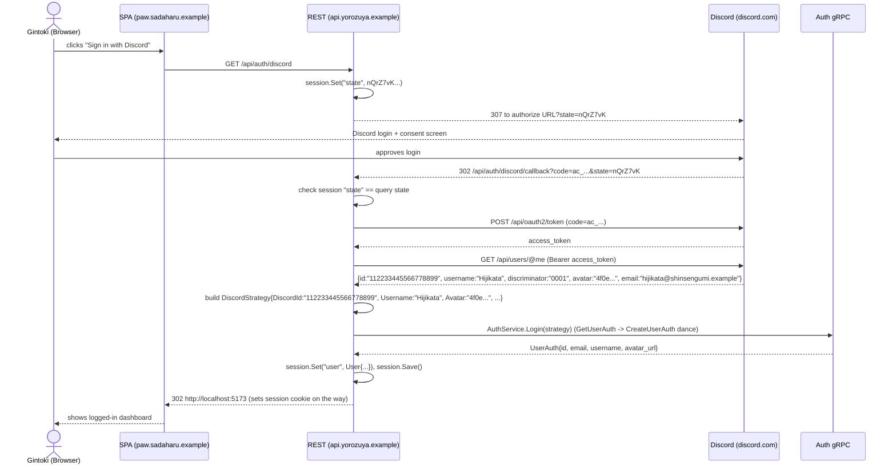
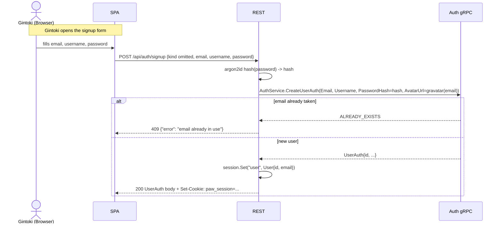
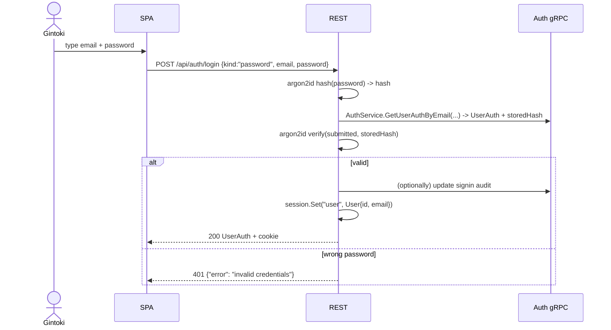
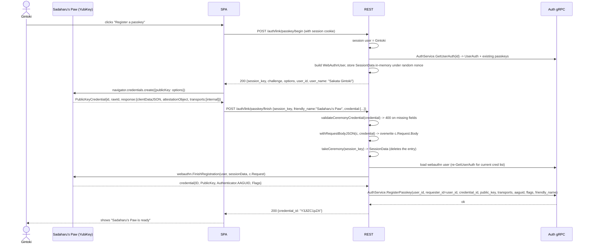
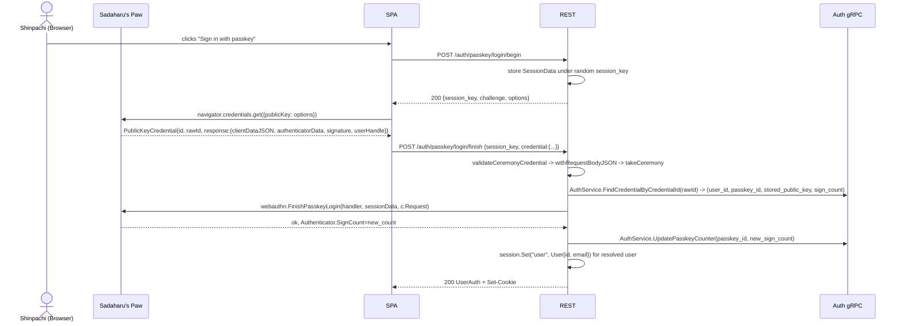
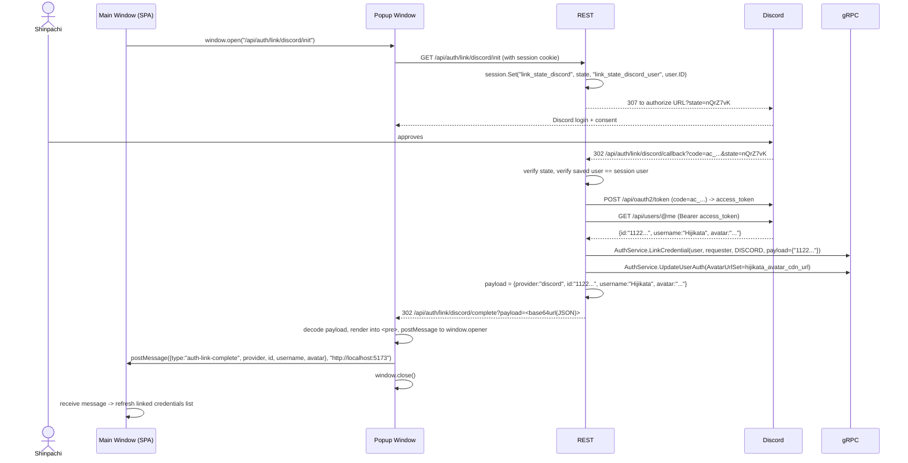
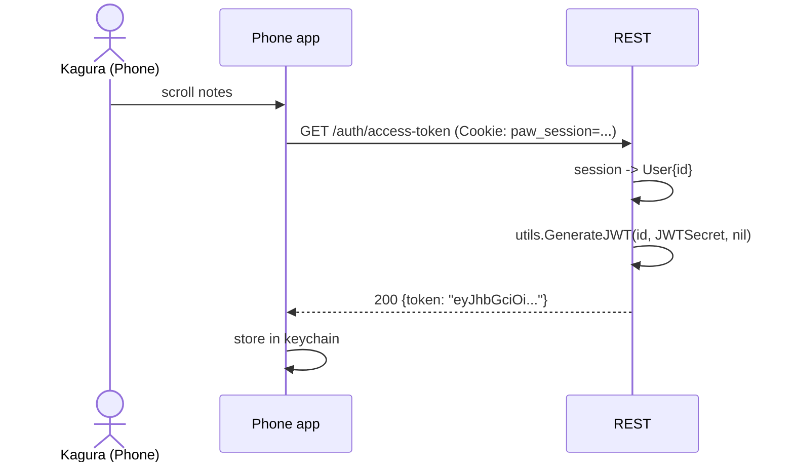

# `controllers/auth` — auth flow cookbook

This is the home of `AuthController`. Every endpoint on
`/api/auth/...` and `/api/users/...` lives here, split across a few
focused files:

| File                  | What it does                                             |
| --------------------- | -------------------------------------------------------- |
| `auth.go`             | Struct, constructor, session-cookie plumbing             |
| `ceremony.go`         | Passkey challenge store (`putCeremony` / `takeCeremony`) |
| `types.go`            | Request and reply shapes                                  |
| `helpers.go`          | Passkey body shims, transport conversion                 |
| `users.go`            | `POST/PATCH /api/users`, `GET /auth/user`, logout        |
| `sessions.go`         | JWT issuance (`/auth/access-token`, `/auth/public-access-token`) |
| `oauth_discord.go`    | Discord login/callback (top-level redirect)              |
| `oauth_google.go`     | Google login/callback (top-level redirect)               |
| `password.go`         | Password signup + signin                                 |
| `link_oauth.go`       | Popup-based OAuth account linking + postMessage HTML     |
| `link_credentials.go` | Non-popup linking, password change, "my credentials"     |
| `passkey.go`          | All passkey ceremonies (register, login, link)           |

The rest of this file is a walk-through of the main flows, with
mermaid sequence diagrams and example request/response bodies. All
example values are themed around the cast of *Gintama*.

## Cast of characters (example values)

- **Gintoki Sakata** — the person trying to log in. They run the
  Yorozuya (odd jobs) shop, password-signs up first, and later adds a
  passkey.
- **Kagura** — Gintoki's friend; logs in from her phone and goes
  through the JWT flow.
- **Shinpachi** — Gintoki's other friend; logs in via the Discord
  link on their existing account.
- **The SPA** — Sadaharu's Paw (`paw.sadaharu.example`), a single-page
  app running in the browser.
- **The REST server** — `api.yorozuya.example` (this code).
- **The gRPC backend** — `grpc.yorozuya.example` (the auth service
  that actually owns users and credentials).
- **Discord** — the OAuth identity provider. The wire shapes in the
  diagrams are the real Discord OAuth2 + `discord.com/api/users/@me`
  responses.
- **Sadaharu's Paw** — a YubiKey, the local passkey authenticator
  with the friendly name "Sadaharu's Paw".

## Glossary of identifiers you will see in the diagrams

| Field           | What it is                                      | Gintama example                 |
| --------------- | ----------------------------------------------- | ------------------------------- |
| `user_id`       | Stable DB id (UUIDv7) for the user              | `0190f3a1-2b6d-7c0e-9a4a-gintoki0001` |
| `email`         | Login email                                     | `gintoki@yorozuya.example`      |
| `username`      | Display name                                    | `Sakata Gintoki`                |
| `password`      | Plaintext over HTTPS, hashed server-side        | `yorozuya-forever`              |
| `state`         | Random CSRF token, base64url(16 random bytes)   | `nQrZ7vK...`                    |
| `code`          | One-time OAuth authorization code               | `ac_Discord_Gintoki`            |
| `session_key`   | Random nonce for a WebAuthn ceremony, base64url | `kSessionCeremony01...`         |
| `credential`    | The browser's resolved `PublicKeyCredential`    | see below                       |
| `friendly_name` | Human label for a newly-registered passkey      | `Sadaharu's Paw`                |

---

## 1. OAuth login (Discord)

This is the "Sign in with Discord" flow. Most of the time this
happens invisibly: a "sign in" button on the SPA kicks it off, the
user comes back with a session cookie already set.

### 1.1 Sequence



### 1.2 What each side does

| Side           | Responsibility                                                                    |
| -------------- | --------------------------------------------------------------------------------- |
| **SPA**        | User clicks "Sign in". Redirects to `/api/auth/discord`. After the 302 back, fetches the user via session cookie. |
| **REST server** | Mints the CSRF `state` and stores it in the session. After the callback, exchanges the code at Discord, fetches the userinfo, hands the verified profile to the `DiscordStrategy`. Sets the session cookie. |
| **Discord**    | Authenticates the user, asks for consent, then 302-redirects back with `code` and `state`. |
| **gRPC backend** | Owns users and credentials. `Login` does `GetUserAuth(discord_id)` -> `CreateUserAuth(...)` if no row exists. |

### 1.3 The wire shapes

**Step 1 — the kick-off redirect.** No request body.

```
GET /api/auth/discord HTTP/1.1
Cookie: paw_session=<existing>

307 Temporary Redirect
Location: https://discord.com/oauth2/authorize
    ?client_id=yorozuya-spa
    &redirect_uri=https%3A%2F%2Fapi.yorozuya.example%2Fapi%2Fauth%2Fdiscord%2Fcallback
    &response_type=code
    &scope=identify+email
    &state=nQrZ7vK...
```

**Step 2 — the callback.** Same path, browser follows it automatically.

```
GET /api/auth/discord/callback?code=ac_Discord_Gintoki&state=nQrZ7vK...
Cookie: paw_session=<with state nQrZ7vK...>
```

**Step 3 — the userinfo response.** Discord's JSON, REST server only consumes it.

```json
{
  "id": "112233445566778899",
  "username": "Hijikata",
  "discriminator": "0001",
  "avatar": "4f0e2cba18ad6cf6e4df7c1e9bbab6ce",
  "email": "hijikata@shinsengumi.example",
  "verified": true
}
```

**Step 4 — the final 302 back to the SPA.**

```
307 Temporary Redirect
Location: http://localhost:5173/
Set-Cookie: paw_session=...; HttpOnly; SameSite=Lax
```

After landing, the SPA calls `GET /api/auth/user` with the cookie and
gets the canonical user shape back.

---

## 2. Password signup + signin

This is the simple "I typed my email and password, you logged me in"
flow. Plaintext in transit; argon2id hashing server-side; constant-time
compare on the way in.

### 2.1 Sequence



For signin (the second visit):



### 2.2 What each side does

| Side           | Responsibility                                                             |
| -------------- | -------------------------------------------------------------------------- |
| **SPA**        | Two forms: signup (`email + username + password`) and signin (`email + password`). No hashing, no crypto. |
| **REST server** | Hashes the password with argon2id before every gRPC call; on signin does the constant-time compare; on success writes the session cookie. |
| **gRPC backend** | Owns the user row, the credential row (`PASSWORD`), and (later) the audit log. Returns `ALREADY_EXISTS` on signup dupes and `NotFound`/`InvalidCredentials` on bad signins. |

### 2.3 The wire shapes

**Signup request**

```http
POST /api/auth/signup
Content-Type: application/json

{
  "email": "gintoki@yorozuya.example",
  "username": "Sakata Gintoki",
  "password": "yorozuya-forever"
}
```

**Signup response (200)**

```json
{
  "id": "0190f3a1-2b6d-7c0e-9a4a-gintoki0001",
  "email": "gintoki@yorozuya.example",
  "username": "Sakata Gintoki",
  "avatar_url": "https://www.gravatar.com/avatar/2c2a...?d=identicon",
  "created_at": "2026-10-12T10:00:00Z"
}
```

**Signin request**

```http
POST /api/auth/login
Content-Type: application/json

{
  "kind": "password",
  "email": "gintoki@yorozuya.example",
  "password": "yorozuya-forever"
}
```

The signin response is the same `UserAuth` shape, plus the cookie.

---

## 3. Passkey registration (new device)

Gintoki already has a password account. Now Sadaharu gives him a YubiKey
("Sadaharu's Paw") and they want to add a passkey to the existing
account. There are two endpoints, `/begin` and `/finish`, with the
session cookie holding the active session across both.

### 3.1 Sequence



### 3.2 What each side does

| Side           | Responsibility                                                                  |
| -------------- | ------------------------------------------------------------------------------- |
| **YubiKey / browser** | Authenticates the attestation via the platform's WebAuthn API. Hands back a base64url-no-pad `PublicKeyCredential`. |
| **SPA**        | Calls `/begin` -> feeds `options` to `navigator.credentials.create` -> POSTs the resolved `credential` (and `session_key` + optional `friendly_name`) to `/finish`. |
| **REST server** | (1) Generates a random challenge, stores `SessionData` for ~5 minutes keyed by a random nonce (`session_key`). (2) On `/finish`, validates the credential's shape (typed credential, rawId, clientDataJSON), stamps it as the request body for the lib, pulls SessionData, calls `webauthn.FinishRegistration`, then `AuthService.RegisterPasskey`. |
| **gRPC backend** | Persists the new passkey row (credential id, public key, transports, AAGUID, flags, friendly name) and links it to the user. The sign counter starts at 0. |

### 3.3 The wire shapes

**Begin**

```http
POST /auth/link/passkey/begin
Cookie: paw_session=<with session user Sakata Gintoki>
```

```json
{
  "session_key": "kSessionCeremony01b2c3d4e5f6",
  "challenge": "Y2hhbGxlbmdl...",
  "options": {
    "rp": {"id": "yorozuya.example", "name": "Yorozuya"},
    "user": {"id": "MDE5MGYzYTEt...", "name": "Sakata Gintoki", "displayName": "Sakata Gintoki"},
    "challenge": "Y2hhbGxlbmdl...",
    "pubKeyCredParams": [{"type": "public-key", "alg": -7}, ...],
    "excludeCredentials": [...],
    "timeout": 60000
  },
  "user_id": "MDE5MGYzYTEt...",
  "user_name": "Sakata Gintoki"
}
```

**Finish**

```http
POST /auth/link/passkey/finish
Cookie: paw_session=<same>
Content-Type: application/json

{
  "session_key": "kSessionCeremony01b2c3d4e5f6",
  "friendly_name": "Sadaharu's Paw",
  "credential": {
    "id": "Y3JlZC1pZA",
    "rawId": "Y3JlZC1pZA",
    "type": "public-key",
    "response": {
      "clientDataJSON": "eyJ0eXBlIjoid2ViYXV0aG4uY3JlYXRlIn0",
      "attestationObject": "o2NmbXRkbm9uZWA",
      "transports": ["internal"]
    },
    "clientExtensionResults": {}
  }
}
```

```json
HTTP/1.1 200 OK
{ "credential_id": "Y3JlZC1pZA" }
```

If the browser hangs longer than 5 minutes between `/begin` and
`/finish`, the controller rejects with `400 ceremony expired at ...`
— the SPA should start a fresh ceremony.

---

## 4. Passkey login (an existing passkey signs in)

This is the discoverable (resident-key) assertion flow. The browser
asks Gintoki to tap Sadaharu's Paw and decides which credential to use
based on what's resident on the key. The user is identified from the
`userHandle` returned inside the assertion.

### 4.1 Sequence



### 4.2 What each side does

| Side         | Responsibility                                                                |
| ------------ | ----------------------------------------------------------------------------- |
| **YubiKey**  | Picks the credential from its store, signs the challenge with the private key, returns the assertion (authenticatorData + signature) and bumps its internal counter. |
| **SPA**      | `/begin` -> feed to `navigator.credentials.get({publicKey, mediation: 'optional'})` -> `/finish` with the resolved credential. |
| **REST server** | Resolves the user from `(credential_id, user_handle)` via gRPC, verifies the signature, updates the sign counter, logs the user in (session cookie + canonical user). |
| **gRPC backend** | Persists the new sign count (replay-detector) and audits the login. |

### 4.3 The wire shapes

The `/begin` body is empty; the response is the same shape as a
registration `/begin` minus `user_id` and `user_name`. The `/finish`
body is the same `PasskeyCeremonyFinishRequest` shape as registration,
minus `friendly_name` — and the embedded `credential.response` carries
assertion fields:

```json
{
  "session_key": "kSessionLogin01b2c3d4e5f6",
  "credential": {
    "id": "Y3JlZC1pZA",
    "rawId": "Y3JlZC1pZA",
    "type": "public-key",
    "response": {
      "clientDataJSON": "eyJ0eXBlIjoid2ViYXV0aG4uZ2V0In0",
      "authenticatorData": "Y3J4eHRzWQ",
      "signature": "MEUCIQDxY3VyZUNpZFNpZ19f",
      "userHandle": "MDE5MGYzYTEt..."
    }
  }
}
```

The HTTP response is the same `UserAuth` shape that any login
endpoint produces.

---

## 5. Popup-based account linking

This is the "Settings -> Security -> Link Discord identity" flow.
The SPA opens a popup window; the popup runs the full OAuth dance on
its own, then `postMessage`s the result back to the main window.

The session cookie is **shared** between popup and main window
(`SameSite=Lax` allows the top-level popup navigation to send it).
That cookie plays two roles: it is the auth that proves who is
linking, and it is the CSRF store for the `state` parameter.

### 5.1 Sequence



If the popup is closed by the user (or blocked by the browser), the
SPA falls back to `POST /api/auth/link/discord?discord_id=1122...` —
the SPA performs the OAuth code exchange itself in that case and
hands the resolved `discord_id` back to the server.

### 5.2 What each side does

| Side          | Responsibility                                                                |
| ------------- | ----------------------------------------------------------------------------- |
| **Main window** | Opens the popup, waits for the postMessage, refreshes the linked credentials list. |
| **Popup window** | Walks the user through Discord's consent. After the callback 302-redirects into `/complete`, decodes the `payload` query param and posts it to `window.opener`. If `window.opener` is missing, it renders the JSON into the page so Shinpachi can copy it by hand. |
| **REST server**  | On `/init`: stores both `state` and a copy of the current user id in the session. On `/callback`: verifies state, exchanges the code, fetches userinfo, calls `LinkCredential` (NOT creating a user), optionally refreshes the user's `avatar_url`. Always 302s to `/complete`, with an error payload if anything failed. |
| **gRPC backend** | `LinkCredential` attaches the new discord id to the existing user. Returns `ALREADY_EXISTS` if the discord id is already linked to a different user — surfaced as a popup error payload. |

### 5.3 The wire shapes

**Step 1 — the popup's first GET.** Empty path params, session cookie
and that's it.

```
GET /api/auth/link/discord/init
Cookie: paw_session=<with user Sakata Gintoki>

307 Temporary Redirect
Location: https://discord.com/oauth2/authorize
    ?client_id=...
    &redirect_uri=https%3A%2F%2Fapi.yorozuya.example%2Fapi%2Fauth%2Flink%2Fdiscord%2Fcallback
    &response_type=code
    &scope=identify+email
    &state=nQrZ7vK...
```

The state for a link flow is namespaced in the session so it cannot
collide with a concurrent login flow (`link_state_discord` instead of
`state`).

**Step 2 — the `/complete` HTML page.** The payload is a base64url
JSON object the popup decodes:

```json
{
  "type": "auth-link-complete",
  "provider": "discord",
  "id": "112233445566778899",
  "username": "Hijikata",
  "avatar": "4f0e2cba18ad6cf6e4df7c1e9bbab6ce"
}
```

On an error it looks like:

```json
{
  "type": "auth-link-complete",
  "provider": "discord",
  "error": "link discord failed: rpc error: code = AlreadyExists desc = credential is already linked to another user"
}
```

The HTML page posts it to `window.opener` and `window.close()`s. The
SPA's `message` handler then refreshes the linked credentials list and
shows a toast.

---

## 6. JWT issuance (the sugar on top)

Once Gintoki is logged in, he needs an access token to call non-cookie
endpoints (the SDK on his phone, the desktop app, the CI bot). Kagura
hits this from her phone right after her session cookie sets.



For share-link guests (no session, just a `share_id`), the same
endpoint at `POST /auth/public-access-token` issues a short-lived JWT
bound to the share's `access_as` user id and the share's
`online_until` timestamp.

---

## Quick troubleshooting

| Symptom                                     | Where to look                                            |
| ------------------------------------------- | -------------------------------------------------------- |
| `400 ceremony expired at ...` on a /finish  | Browser took longer than 5 min between /begin and /finish. The SPA should kick a fresh /begin. |
| `403 state does not match session user`     | Session changed between /init and /callback. Re-open the linking flow. |
| `503 passkey support is not configured`     | Operator did not set `WEBAUTHN_RP_ID`.                   |
| `409 email already in use` on signup        | The email is taken; the SPA should send Gintoki to the signin form instead. |
| `503 OAuth linking for "google" is not configured` | The matching `*_LINK_REDIRECT_URI` env var is unset. The SPA should fall back to `POST /api/auth/link/google`. |
